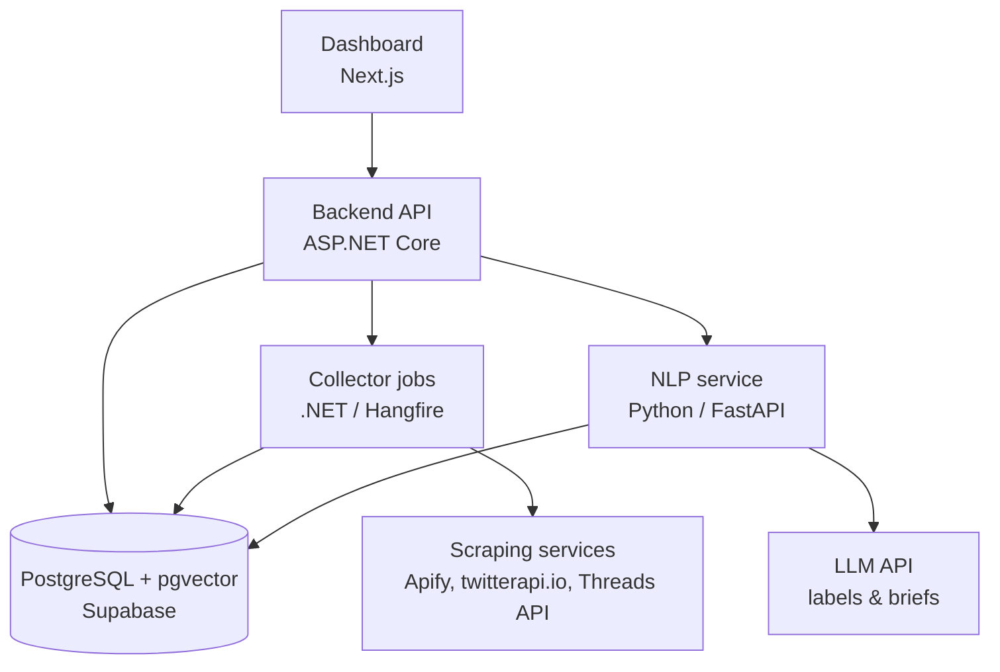

# PakPulse — Architecture

> **Purpose:** Describes what PakPulse is made of, how the parts connect, and the limits it works within.

**Related docs:** [Decisions (the "why")](DECISIONS.md) · [Flow (runtime behaviour)](FLOW.md) · [Progress](PROGRESS.md) · [Backend guide](../app/backend/CLAUDE.md) · [Frontend design](../app/frontend/DESIGN.md) · [Root guide](../CLAUDE.md) · [README](../README.md)

---

## Overview

PakPulse collects recent social media posts on an analyst-defined topic and labels each one for mood, stance and sarcasm. It then groups the posts into narratives and reports the results on a dashboard with an evidence-linked daily brief. The current build is a **local prototype** (see [Progress](PROGRESS.md)).

### Design goals

- **Low cost:** pay-per-result data, a cheap model for labelling, no hosting cost, and spending caps.
- **Swappable sources:** every platform sits behind one interface ([D-015](DECISIONS.md#d-015-common-interface-for-every-data-source)).
- **Multilingual:** English, Urdu (Urdu script) and Roman Urdu (often mixed with English).
- **Evidence-linked outputs:** every insight and brief links back to the real posts.
- **Honest uncertainty:** every label carries a confidence score ([D-013](DECISIONS.md#d-013-confidence-score-on-every-label)).

### Ethical boundary

PakPulse does **aggregate narrative analysis, not profiling of individuals**. Do not design features that track or profile specific private individuals, such as journalists or critics. Key accounts ([D-006](DECISIONS.md#d-006-monitor-key-accounts-and-a-small-keyword-set)) are only a collection source.

## Diagram

## Components

| Component | Tech | Responsibility | Boundary |
|---|---|---|---|
| **Dashboard** | Next.js, with hand-drawn SVG charts ([D-022](DECISIONS.md#d-022-dashboard-look-the-forest-frame)) | Create topics and keywords. View trend charts, the mood and stance breakdown, top narratives, sample posts and the AI daily brief. Work the human review queue. | Talks **only** to the Backend API. See [Frontend design](../app/frontend/DESIGN.md). |
| **Backend API** | ASP.NET Core + Entity Framework Core | The single front door for the dashboard. Manages topics, serves results, and triggers collection and analysis runs. | See [Backend guide](../app/backend/CLAUDE.md). |
| **Collector jobs** | Inside the .NET backend. Hangfire for scheduling (the prototype can use a "Collect now" button) | Call the scraping services and the Threads API, save raw results, and normalise every platform into one common post format. | One `ISourceCollector` per source. |
| **Database** | PostgreSQL + pgvector, hosted on Supabase for the prototype ([D-020](DECISIONS.md#d-020-host-the-prototype-database-on-supabase)) | Topics, raw posts, cleaned posts, labels, embeddings, narratives and briefs. | The single store ([D-011](DECISIONS.md#d-011-single-postgresql-database-with-pgvector)). Details: [Database](DATABASE.md). |
| **NLP service** | Python + FastAPI (**proposed**, [D-010](DECISIONS.md#d-010-add-a-python-nlp-service)) | Clean text and detect language. Send posts to the LLM in batches for mood, stance and sarcasm. Compute embeddings, group posts into narratives with BERTopic, and draft the daily brief. | Called by the backend over HTTP. Repo location **TBD**. |
| **LLM API** | External, pay-per-use (provider **TBD**) | Labelling (cheap model) and brief writing (stronger model). | [D-012](DECISIONS.md#d-012-two-tier-llm-via-api) |
| **Scraping services** | External: Apify / twitterapi.io (X, Instagram), Meta Threads API | Source data. | [D-001](DECISIONS.md#d-001-do-not-build-our-own-scrapers) to [D-004](DECISIONS.md#d-004-do-not-use-the-official-x-api-for-now) |

> If D-010 is rejected in favour of the .NET-only option, the NLP responsibilities move into the backend and the NLP service box disappears from the diagram.

## Data sources

| Platform | Approach | Decision |
|---|---|---|
| X (Twitter) | Pay-per-result scraping service (Apify or twitterapi.io; provider **TBD**) | [D-002](DECISIONS.md#d-002-use-ready-made-scraping-services-for-x-and-instagram), [D-004](DECISIONS.md#d-004-do-not-use-the-official-x-api-for-now) |
| Instagram | Apify, pay per result | [D-002](DECISIONS.md#d-002-use-ready-made-scraping-services-for-x-and-instagram) |
| Threads | Meta's free official Threads API (rationed). Fallback: buy via Apify | [D-003](DECISIONS.md#d-003-use-the-official-threads-api-for-threads) |

- No in-house scraping ([D-001](DECISIONS.md#d-001-do-not-build-our-own-scrapers)) and no historical data ([D-005](DECISIONS.md#d-005-no-historical-data)).
- Collection targets curated key accounts plus a small keyword set ([D-006](DECISIONS.md#d-006-monitor-key-accounts-and-a-small-keyword-set)), with the most-engaged posts first and retweets counted, not collected ([D-007](DECISIONS.md#d-007-collect-smart)).

## Data storage

These are conceptual layers in one PostgreSQL + pgvector database:

| Layer | What it holds |
|---|---|
| **Topics** | Analyst-defined keywords (English / Urdu / Roman Urdu), categories and key accounts. |
| **Raw posts** | Untouched source responses as JSONB, kept so they can be re-processed when models improve. |
| **Cleaned posts** | Deduplicated, normalised common post format with a language tag. Unique on platform + post ID ([D-016](DECISIONS.md#d-016-never-analyse-the-same-post-twice)). |
| **Labels** | Mood, stance and sarcasm per post, each with a confidence score, plus human corrections. |
| **Embeddings** | Vector per post (pgvector), used for narrative grouping. |
| **Narratives** | Groups of posts, growth indicators and links to member posts. |
| **Briefs** | AI-written daily briefs with links to source posts. |

**Detailed schema:** see [Database](DATABASE.md). The SQL scripts are the master copy ([D-021](DECISIONS.md#d-021-database-first-sql-scripts-are-the-master-copy)).

## NLP and AI layer

1. **Language detection:** English, Urdu (Urdu script) or Roman Urdu, including mixed text.
2. **Per-post labels** (cheap LLM, ~20 posts per request, strict JSON):
   - **Mood:** sentiment and emotion.
   - **Stance toward the topic:** supportive, critical or neutral.
   - **Sarcasm likelihood.**
   - Every label carries a **confidence score**. Low confidence sends the post to human review ([D-013](DECISIONS.md#d-013-confidence-score-on-every-label)).
   - Context such as the parent post or thread is used where available.
3. **Embeddings** for each post, stored in pgvector.
4. **Narratives:** group posts with BERTopic and flag fast-growing or emerging narratives.
5. **Daily brief:** the stronger LLM writes a brief that links to real posts as evidence ([D-012](DECISIONS.md#d-012-two-tier-llm-via-api)).

**Biggest technical risk:** Roman Urdu accuracy and sarcasm detection. Both stay unproven until tested on our labelled domain set ([D-014](DECISIONS.md#d-014-build-a-labelled-domain-dataset)).

## Engineering practices

- Source collectors sit behind one interface, `ISourceCollector` ([D-015](DECISIONS.md#d-015-common-interface-for-every-data-source)).
- LLM calls are batched (~20 posts per request) with strict JSON output.
- Every label stores a confidence score. Low-confidence labels go to a human review queue, and corrections become the test set.
- Deduplicate and cache, so a post is never analysed twice ([D-016](DECISIONS.md#d-016-never-analyse-the-same-post-twice)).
- Test every pipeline step on ~100 posts before running the full collection.
- Set a **spending cap** on every paid service.
- Run the app locally ([D-017](DECISIONS.md#d-017-run-locally-with-docker-compose)); the prototype database is on Supabase ([D-020](DECISIONS.md#d-020-host-the-prototype-database-on-supabase)).
- Never commit API keys or secrets.

## Cost model

All figures are in Pakistani Rupees, converted at ~Rs 278 per USD. Services bill in USD, so rupee figures move with the exchange rate, and card payments from Pakistan may add bank or tax charges. Prices are approximate, as researched in Oct 2026, and **must be re-verified before purchase**.

**Unit prices**

| Source | Approx. cost per 1,000 posts |
|---|---|
| X via scraping services | Rs 40–110 |
| Instagram via Apify | Rs 420–750 |
| Threads via scraping services | Rs 830–2,220 (official API free but rationed) |
| Official X API (comparison) | ~Rs 1,390 |

**Prototype (one-off, ~Rs 2,000 budget):** an estimated ~Rs 1,000–2,000 in total for data and AI, with no hosting cost. The itemised budget and actual spend are tracked in [Progress → Budget tracker](PROGRESS.md#budget-tracker).

**Future monthly running cost** (data + AI + hosting only; excludes developer time)

| Scenario | Est. per month |
|---|---|
| Pilot (one topic, ~1,000 posts/day) | Rs 20,000–40,000 |
| Full system (~5,000 posts/day) | Rs 40,000–125,000 |
| Same volume via official X API | Rs 181,000–250,000 |

## Risks and constraints

- **Legal:** a legal view is needed on using scraping services for a government-linked client, because of ToS risk.
- **Data protection:** InfinityX Digital LTD is UK-based, so UK GDPR applies. Public posts are still personal data. A DPIA and a legitimate-interest basis are needed. Keep to aggregate analysis (see [Ethical boundary](#ethical-boundary)).
- **Hosting and data residency:** the client may require hosting in Pakistan. This matters beyond the prototype. The prototype database is on Supabase in Mumbai; we plan to self-host afterwards ([D-020](DECISIONS.md#d-020-host-the-prototype-database-on-supabase)).
- **Accuracy:** Roman Urdu and sarcasm detection are unproven until tested on a labelled domain set.
- **Threads API app review** may delay Threads data ([D-003](DECISIONS.md#d-003-use-the-official-threads-api-for-threads)).
- **Pakistan X access history:** X was blocked in Pakistan from Feb 2024 to May 2025. This affects comparisons with older local data, but API access from servers abroad is unaffected.
- **Existing subscriptions:** check whether the client already has a monitoring subscription whose data could be used.
- **Prices** are point-in-time estimates and must be re-verified.

Risks being tracked are listed in [Progress → Risks to watch](PROGRESS.md#risks-to-watch).

## Future extensions

- More sources: YouTube, Telegram, Bluesky, news via GDELT/RSS, and Reddit.
- **SignalR** live spike alerts on the dashboard (not needed for the demo).
- **Coordinated or bot activity detection:** bursts of near-identical posts, synchronised timing, and new accounts amplifying one hashtag. Mostly graph analysis plus heuristics.
- **BERTrend-style** early "weak signal" detection.
- Hourly scheduled collection via Hangfire (see [Flow](FLOW.md#prototype-vs-future-mode)).
