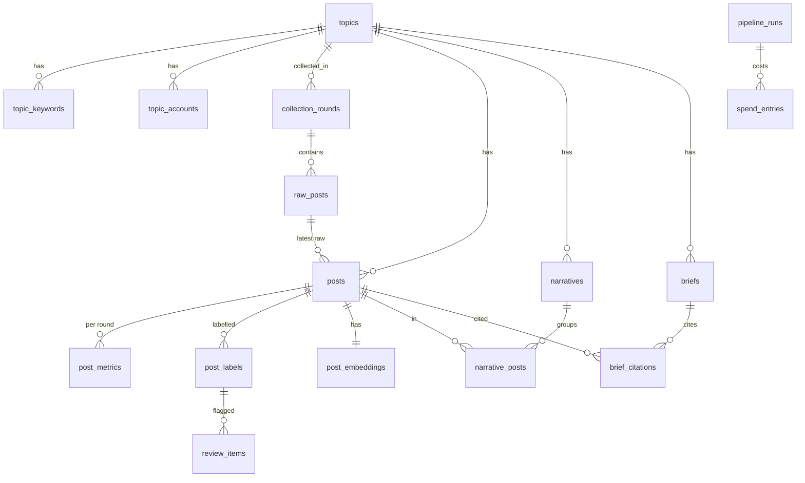

# PakPulse — Database

> **Purpose:** What the database holds, where it runs, how to change it and how the backend connects to it.

**Related docs:** [Architecture → Data storage](ARCHITECTURE.md#data-storage) · [Decisions](DECISIONS.md) · [Flow](FLOW.md) · [Progress](PROGRESS.md) · [Backend guide](../app/backend/CLAUDE.md) · [Phase 1 plan](PHASE1_DATABASE_PLAN.md)

---

## At a glance

| | |
|---|---|
| Where | **Supabase** (hosted PostgreSQL), free plan, region **ap-south-1 (Mumbai)**. Prototype only; we plan to self-host later ([D-020](DECISIONS.md#d-020-host-the-prototype-database-on-supabase)). |
| Schema | Everything lives in the **`pakpulse`** schema, not `public` |
| Tables | 16, in 6 groups (below) |
| Master copy | The numbered SQL scripts in [app/database/migrations/](../app/database/migrations/) ([D-021](DECISIONS.md#d-021-database-first-sql-scripts-are-the-master-copy)) |
| Status | Created 2026-10-20. Empty: no data yet. |

## How to change the database

The SQL scripts are the **master copy**. The database and the backend's C# models both follow them.

1. Write a **new** numbered script in `app/database/migrations/`, e.g. `004_add_something.sql`. **Never edit a script that has already been run.**
2. Run it in Supabase: **SQL Editor → + New query → paste → Run**.
3. Update the backend's C# models to match.
4. Commit the script and the model changes together.

Never change tables by hand in Supabase's Table Editor. The scripts would then no longer match the real database.

### Scripts run so far

| Script | What it does | Run on |
|---|---|---|
| [001_initial_schema.sql](../app/database/migrations/001_initial_schema.sql) | Creates the schema, the `vector` extension and all 16 tables, and switches on RLS | 2026-10-20 |
| [002_lock_rls_helper.sql](../app/database/migrations/002_lock_rls_helper.sql) | Removes public access to `public.rls_auto_enable()`, a helper that Supabase's "Run and enable RLS" button adds | 2026-10-20 |
| [003_emotion_list.sql](../app/database/migrations/003_emotion_list.sql) | Switches the emotion list to the dashboard's set | 2026-10-20 |

**To rebuild from scratch** (e.g. a new Supabase project or self-hosting): run the scripts in number order.

## Tables

A **collection round** is one round of collecting posts at a point in time (Collection round 1, Collection round 2…). The prototype uses 2–3 rounds ([D-007](DECISIONS.md#d-007-collect-smart)).

### A. Topic setup

| Table | Holds |
|---|---|
| `topics` | The topic being monitored. Its `description` is given to the AI so it can judge stance. |
| `topic_keywords` | Search terms, each tagged `en`, `ur` or `roman_ur` |
| `topic_accounts` | Key accounts to collect from. A collection list only: never used to profile anyone ([ethical boundary](ARCHITECTURE.md#ethical-boundary)). |

### B. Collection (raw data, untouched)

| Table | Holds |
|---|---|
| `collection_rounds` | One row per round: number, label, status, start and finish times |
| `raw_posts` | Exactly what the source sent back (JSON), one row per post per round. Kept so posts can be re-processed when the models improve. |

### C. Cleaned posts

| Table | Holds |
|---|---|
| `posts` | One row per real post in one common format: text, language, author, time, link, engagement, hashtags, media links. **Unique per topic + platform + post ID**, so a post is never stored or analysed twice ([D-016](DECISIONS.md#d-016-never-analyse-the-same-post-twice)). |
| `post_metrics` | A post's engagement numbers in each round, used to spot what is growing |

Reposts are not stored as posts; they count towards the original's `reposts` ([D-007](DECISIONS.md#d-007-collect-smart)). Photos and videos are never downloaded, only their links. There is no author profile table.

### D. Analysis

| Table | Holds |
|---|---|
| `post_labels` | Sentiment, emotion, stance and sarcasm for each post, each with a confidence score from 0 to 1 ([D-013](DECISIONS.md#d-013-confidence-score-on-every-label)). A human correction adds a new label and keeps the AI one, so pairs of the two become the test set. Only one label per post is "current". |
| `review_items` | The human review queue for low-confidence labels |
| `post_embeddings` | One "meaning" vector per post, for grouping posts into narratives. Its size is set once the embedding provider is chosen. |

### E. Insights

| Table | Holds |
|---|---|
| `narratives` | Groups of posts telling the same story, with their share in the latest and previous rounds and a growth score |
| `narrative_posts` | Which posts belong to which narrative |
| `briefs` | The AI-written daily brief |
| `brief_citations` | The real posts each brief links to as evidence |

### F. Operations and budget

| Table | Holds |
|---|---|
| `pipeline_runs` | Every processing run (collect, clean, label…): status, counts, errors and whether it was a 100-post test run |
| `spend_entries` | Estimated cost of each paid call, in USD with the exchange rate used, so spending caps can be checked and rupees shown |

### Allowed values

The database rejects any other value.

| Field | Allowed values |
|---|---|
| Platform | `x`, `instagram`, `threads` |
| Language | `en`, `ur`, `roman_ur`, `mixed`, `other` (keywords: `en`, `ur`, `roman_ur` only) |
| Sentiment | `positive`, `negative`, `neutral`, `mixed` |
| Emotion | `anger`, `worry`, `humour`, `disappointment`, `hope`, `none` |
| Stance | `supportive`, `critical`, `neutral`, `off_topic` |
| Label source | `llm`, `human` |
| Post status | `new`, `clean`, `dropped` |
| Raw post source | `file_import`, `apify`, `twitterapi_io`, `threads_api`, `custom` |
| Account category | `official`, `journalist`, `analyst`, `commentator`, `news` |

## Security

- **Row Level Security (RLS) is on for every table, with no policies.** Supabase's public web API therefore cannot read or write anything. Only the backend's own database login can. The Security Advisor may list "RLS enabled, no policy" notes for these tables: that is intended.
- The `pakpulse` schema is **not** in Supabase's exposed schemas (Project Settings → Data API). Keep it that way.

## Connecting

| | |
|---|---|
| Method | **Session pooler** (works on IPv4 networks; the transaction pooler can break the .NET database tools) |
| Host | `aws-0-ap-south-1.pooler.supabase.com` |
| Port | `5432` |
| Database | `postgres` |
| User | `postgres.mwbhrzvhloqlrcrcrlwh` |
| Password | Held by Shahab. **Never in the repo, in chat or in `appsettings.json`.** |

The backend reads the full connection string from .NET **user secrets** on each developer's laptop; see the [Backend guide](../app/backend/CLAUDE.md#secrets-and-connection). The dashboard never connects to the database directly.

## Things to know

- **Free projects pause after 7 days without use.** Before a demo, open the Supabase dashboard and click **Restore** if needed. Data is kept.
- **Free plan limit: 500 MB.** The prototype needs an estimated 100–170 MB.
- Keep each collection round's raw files locally as a backup (they are never committed).
