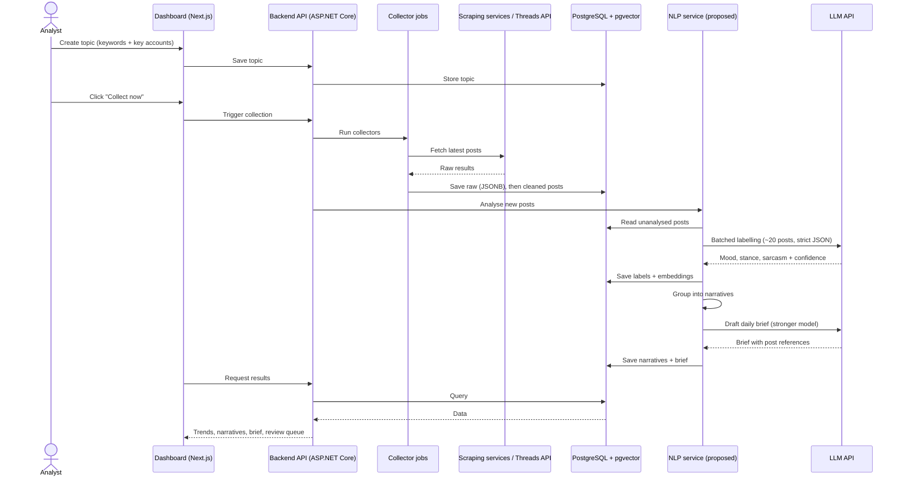

# PakPulse — Workflow and Data Flow

> **Purpose:** Explains how data moves through PakPulse, from a topic definition to the dashboard and daily brief.

**Related docs:** [Architecture](ARCHITECTURE.md) · [Decisions](DECISIONS.md) · [Progress](PROGRESS.md) · [Backend guide](../app/backend/CLAUDE.md) · [Frontend design](../app/frontend/DESIGN.md) · [Root guide](../CLAUDE.md)

---

## The pipeline in plain language

1. **Set topics.** An analyst enters keywords and key accounts in English, Urdu and Roman Urdu ([D-006](DECISIONS.md#d-006-monitor-key-accounts-and-a-small-keyword-set)).
2. **Collect.** The collector pulls the latest posts from X, Instagram and Threads. The prototype uses 2–3 manual snapshots; later collection will be hourly ([D-007](DECISIONS.md#d-007-collect-smart)).
3. **Save the originals.** Raw responses are stored untouched so they can be re-processed when models improve.
4. **Clean.** Remove duplicates and spam, normalise all platforms into one format, and tag the language.
5. **Analyse.** AI labels each post for mood, stance toward the topic and likely sarcasm, using context such as the parent post or thread where available. Each label gets a confidence score, and uncertain posts go to a human for checking.
6. **Spot trends.** Group posts into the main narratives, flag fast-growing ones, and (later) detect coordinated or bot activity.
7. **Report.** The dashboard, spike alerts (future) and a daily written brief that links to the actual posts.

## System-level data flow

1. The analyst creates a topic in the dashboard, and the API saves it.
2. "Collect": the collector pulls posts and stores them raw, then cleaned.
3. The API asks the NLP service to analyse new posts. Labels and embeddings are saved.
4. The NLP service groups posts into narratives and drafts the brief.
5. The dashboard reads everything from the API and displays it.

> The NLP service is **proposed** ([D-010](DECISIONS.md#d-010-add-a-python-nlp-service)). If the .NET-only option is chosen, the backend does steps 3–4 itself.

## Prototype vs future mode

| Aspect | Prototype (now) | Future |
|---|---|---|
| Collection trigger | Manual **"Collect now"** button | **Hangfire** schedule |
| Frequency | 2–3 snapshots over a few days | Hourly |
| Volume | ~6,000 posts in total, for one topic | ~1,000–5,000 posts/day |
| Demo data | **Collect once, save, and reuse for every demo. Never re-scrape for a demo.** | Live |
| Alerts | None | SignalR spike alerts |
| Hosting | Local laptop, Docker Compose | **TBD** (data residency may require Pakistan) |

## Human review loop

1. Any label with a confidence score below a threshold goes to the **review queue**. The threshold value is **TBD**.
2. An analyst checks the post in the dashboard and confirms or corrects the label.
3. Corrections are stored with the post.
4. The corrected posts become the **labelled test set** used to measure accuracy, especially for Roman Urdu and sarcasm ([D-013](DECISIONS.md#d-013-confidence-score-on-every-label), [D-014](DECISIONS.md#d-014-build-a-labelled-domain-dataset)).

## Failure handling

This is high level only. **Detailed behaviour is TBD.**

| Situation | Intended behaviour |
|---|---|
| Scraping service down or erroring | Stop that source's run, keep data already saved, and report the failure on the dashboard. Other sources continue. Switching provider is a single-class change ([D-015](DECISIONS.md#d-015-common-interface-for-every-data-source)). |
| Quota hit (e.g. Threads ~500 queries / 7 days) | Stop querying that source and use the fallback in [D-003](DECISIONS.md#d-003-use-the-official-threads-api-for-threads) if approved. |
| Spending cap reached | Stop paid calls immediately. Never raise a cap without Shahab's approval. |
| LLM returns invalid JSON | Retry the batch. Details TBD. |
| Post already analysed | Skip it ([D-016](DECISIONS.md#d-016-never-analyse-the-same-post-twice)). |
