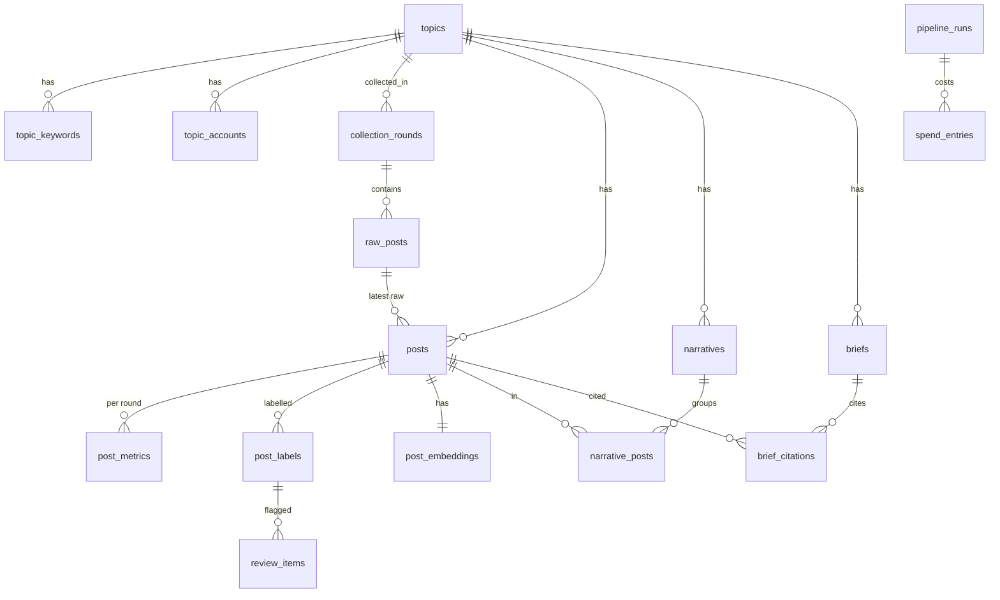

# PakPulse — Phase 1 Plan: Database (Supabase) + Backend Data Layer

> **Purpose:** The agreed plan for Phase 1: the database design (Supabase), the .NET data layer, and the Supabase setup steps.
>
> **Status:** Approved 2026-10-19. Not built yet. Once built, the final table design moves into a dedicated database doc.

**Related docs:** [Progress](PROGRESS.md) · [Architecture](ARCHITECTURE.md) · [Decisions](DECISIONS.md) · [Flow](FLOW.md) · [Backend guide](../app/backend/CLAUDE.md) · [Root guide](../CLAUDE.md)

## Context

We're building the backend in stages, starting with the database. This phase delivers four things:
- the **table design** for everything PakPulse stores (scraped data through to narratives and briefs)
- the **.NET code** that reads and writes it
- **step-by-step Supabase setup** for Shahab
- doc updates

We build it all here, and Shahab's partner takes it over later, so the code and docs must hand over cleanly.

This changes earlier docs. The database moves from a local Docker Postgres (D-017) to **Supabase** (hosted Postgres). Collectors, analysis and API endpoints come in later phases.

**Terminology:** one round of collecting posts at a point in time is called a **collection round** (Collection round 1, Collection round 2…). The prototype uses 2–3 rounds. This replaces the word "snapshot" everywhere.

Open decisions this phase does **not** depend on: scraping approach, D-010 (Python vs .NET-only) and the LLM provider. The design works whichever way they go.

---

## 0. First: share the plan (do this before anything else)

1. Copy this plan into the repo as **`docs/PHASE1_DATABASE_PLAN.md`**, adding a "Related docs" block linked from `docs/PROGRESS.md`.
2. Commit the 8 populated docs plus the plan file with one commit ("Add project docs and Phase 1 database plan"). Nothing else is included: no code, no secrets.
3. Push to `origin main` so Shahab's partner can read it. The repo only holds docs, and Shahab asked for the push.
4. Give Shahab a short prompt for **Claude in Chrome** that does the Supabase dashboard steps 3.1–3.6 below:
   - Shahab logs in and handles the database password himself.
   - The prompt does not do steps 3.7–3.9, because they need the backend code first.

## 1. How the backend talks to the database (simple version)

Think of the database as a set of **spreadsheets** (tables) stored in Supabase. The backend is the program that fills them in and reads them.

- **One template per table.** For each table we write a small template in C# code. For example, a `Post` template has the fields Text, Author and Likes. Every row in the table is one filled-in copy of that template.
- **A translator in the middle (EF Core).** We don't write database commands by hand. The backend simply says "save this post" or "give me all posts from Collection round 2", and EF Core turns that into database commands. It's Microsoft's standard tool for .NET.
- **A plug for Supabase (Npgsql).** Supabase runs on a database called PostgreSQL. Npgsql is the plug that lets EF Core talk to it.
- **Automatic table building (migrations).** When we add or change a template in code, EF Core writes the instructions to create or change the matching table in Supabase. You run one command and Supabase is updated. Each change is saved as a numbered step, so there's a full history and anyone can rebuild the database from scratch.
- **The code is the master copy.** Tables only change when the code changes, never by editing them by hand in Supabase. That keeps the code and the database matched, and makes it easy for your partner to take over.

There are also a few small add-ons:
- one for storing embeddings (the "meaning" numbers for each post)
- one that gives tables tidy lower-case names
- the command-line tool that runs the migrations

---

## 2. Database design

All tables live in their own section of the database called **`pakpulse`**, not the default `public` one. Supabase automatically publishes `public` to the internet through its web API, and keeping our tables separate keeps them private.

### Diagram



### Tables: what is stored where (16 tables, 6 groups)

**A. Topic setup**

| Table | Holds | Key columns |
|---|---|---|
| `topics` | The topic being monitored | `id`, `name`, `description` (fed to the AI to judge stance), `is_active`, `created_at`, `updated_at` |
| `topic_keywords` | Search terms | `topic_id`, `keyword`, `language` (`en` / `ur` / `roman_ur`). Unique (`topic_id`, `keyword`) |
| `topic_accounts` | Key accounts to collect from (collection list only, never profiled) | `topic_id`, `platform` (`x` / `instagram` / `threads`), `handle`, `category` (`official` / `journalist` / `analyst` / `commentator` / `news`). Unique (`topic_id`, `platform`, `handle`) |

**B. Collection (raw data, untouched)**

| Table | Holds | Key columns |
|---|---|---|
| `collection_rounds` | One round of collecting (prototype: 2–3 in total) | `topic_id`, `round_number`, `label` (e.g. "Collection round 1"), `status`, `started_at`, `finished_at`, `notes`. Unique (`topic_id`, `round_number`) |
| `raw_posts` | Exactly what the source returned, one row per post per round | `collection_round_id`, `source` (`file_import` / `apify` / `twitterapi_io` / `threads_api` / `custom`), `platform`, `platform_post_id`, `payload` (the JSON as received), `fetched_at`. Unique (`collection_round_id`, `platform`, `platform_post_id`) |

**C. Cleaned posts (one common format)**

| Table | Holds | Key columns |
|---|---|---|
| `posts` | One row per real post, whatever the platform. **The deduplication point (D-016).** | `topic_id`, `platform`, `platform_post_id`, `url`, `posted_at`, `text`, `text_normalised`, `text_hash` (near-duplicate check), `language` (`en` / `ur` / `roman_ur` / `mixed` / `other`), `author_platform_id`, `author_handle`, `author_display_name`, `author_followers`, `parent_platform_post_id`, `parent_text` (context for the AI), `is_reply`, `is_quote`, `hashtags`, `mentions`, `media_urls` (links only, no files), latest `likes` / `reposts` / `replies` / `quotes` / `views`, `status` (`new` / `clean` / `dropped`), `drop_reason`, `first_seen_round_id`, `last_seen_round_id`, `latest_raw_post_id`. **Unique (`topic_id`, `platform`, `platform_post_id`)** |
| `post_metrics` | Engagement numbers at each round, used to spot fast-growing posts and narratives | `post_id`, `collection_round_id`, `likes`, `reposts`, `replies`, `quotes`, `views`. Key (`post_id`, `collection_round_id`) |

Retweets/reposts are not stored as posts. They show up only in the original post's `reposts` count (D-007). Author details are kept only to show evidence and to weight reach. There is no separate author profile table (ethical boundary). Photos and videos are **not downloaded**; only their links are stored.

**D. Analysis**

| Table | Holds | Key columns |
|---|---|---|
| `post_labels` | AI labels and human corrections | `post_id`, `sentiment` (`positive` / `negative` / `neutral` / `mixed`) + confidence, `emotion` (`anger` / `joy` / `fear` / `sadness` / `pride` / `disgust` / `surprise` / `none`) + confidence, `stance` (`supportive` / `critical` / `neutral` / `off_topic`) + confidence, `sarcasm_probability` + confidence, `language_detected`, `rationale` (short, shown in the review queue), `source` (`llm` / `human`), `model`, `prompt_version`, `is_current`, `pipeline_run_id`, `created_at`. **Only one current label per post** |
| `review_items` | The human review queue | `post_id`, `label_id`, `reason` (which fields were low-confidence), `status` (`pending` / `resolved` / `skipped`), `resolved_at` |
| `post_embeddings` | One meaning-vector per post | `post_id`, `model`, `embedding` (size set later, once the embedding provider is chosen), `created_at` |

A human correction **adds a new label** (`source = human`) and keeps the AI label. Pairs of AI and human labels become the test set (D-013, D-014).

**E. Insights**

| Table | Holds | Key columns |
|---|---|---|
| `narratives` | Groups of posts telling the same story | `topic_id`, `pipeline_run_id`, `title`, `summary`, `post_count`, `share_latest_round`, `share_previous_round`, `growth_score`, `is_emerging`, `created_at` |
| `narrative_posts` | Which posts belong to which narrative | `narrative_id`, `post_id`, `similarity`, `is_representative` |
| `briefs` | The AI daily brief | `topic_id`, `pipeline_run_id`, `brief_date`, `model`, `content_markdown`, `created_at` |
| `brief_citations` | Real posts the brief links to as evidence | `brief_id`, `post_id` |

**F. Operations and budget**

| Table | Holds | Key columns |
|---|---|---|
| `pipeline_runs` | Every processing run (collect, clean, label…) | `topic_id`, `collection_round_id`, `stage`, `status` (`running` / `succeeded` / `failed` / `stopped_budget`), `started_at`, `finished_at`, `items_in`, `items_out`, `error`, `is_test_run` (100-post mode) |
| `spend_entries` | Estimated spend per paid call, checked against the caps | `pipeline_run_id`, `service` (`apify` / `twitterapi_io` / `llm_label` / `llm_brief` / `embeddings`), `units`, `unit_type`, `cost_usd`, `usd_to_pkr_rate`, `created_at` |

Spending caps live in backend settings. Costs are recorded in USD, which is what the services bill in, together with the exchange rate, so the dashboard can show rupees.

**Size check (Supabase free tier = 500 MB):** ~6,000–9,000 raw rows × 5–15 KB ≈ 50–130 MB, plus embeddings ≈ 40 MB. That fits comfortably.

**Security:** each table has row-level security turned on, and Supabase's public web roles get no access to `pakpulse`. Only the backend's own database login can read or write the data.

---

## 3. Supabase setup: step by step (for Shahab)

1. Sign up or log in at supabase.com and use the **Free** plan.
2. **New project:**
   - Name: `pakpulse-prototype`
   - Database password: generate a strong one and **save it in a password manager**
   - Region: **London (eu-west-2)**, because InfinityX is UK-based and UK GDPR applies
3. Wait for setup to finish (about 2 minutes).
4. **Database → Extensions** → search for `vector` → enable it (leave the schema as `extensions`).
5. **Data API settings** → check that *Exposed schemas* is only `public`. **Do not add `pakpulse`.**
6. Click **Connect** (top bar) → **Session pooler** → copy the connection details (host `aws-0-eu-west-2.pooler.supabase.com`, port `5432`, user `postgres.<project-ref>`).
   - Use the **session pooler**. The direct connection may not work on your network. The transaction pooler (port 6543) breaks migrations.
7. **Never paste the password into chat or commit it.** Once the backend project exists, store it on your laptop with:
   ```
   cd app/backend/src/PakPulse.Api
   dotnet user-secrets set "ConnectionStrings:PakPulse" "Host=aws-0-eu-west-2.pooler.supabase.com;Port=5432;Database=postgres;Username=postgres.<project-ref>;Password=<password>;SSL Mode=Require;Search Path=pakpulse,extensions,public"
   ```
8. Build the tables (I'll confirm the exact command once the code is ready):
   `dotnet ef database update --project src/PakPulse.Infrastructure --startup-project src/PakPulse.Api`
9. Check the result: **Table Editor** → schema dropdown → `pakpulse` → 16 tables. Then **Advisors → Security Advisor**, which should show no warnings for `pakpulse`.

Things to know:
- Free projects **pause after 7 days without activity**. Open the dashboard and unpause it before every demo.
- We also keep each collection round's raw files locally in `data/collection-rounds/` (not committed) as a backup.

---

## 4. Backend code: what I'll build

```
app/backend/
├── PakPulse.sln                       ← ties the three projects together
├── .config/dotnet-tools.json          ← pins the migration tool version
└── src/
    ├── PakPulse.Core/                 ← the templates (no database code)
    │   ├── Entities/                  ← Topic, TopicKeyword, TopicAccount, CollectionRound, RawPost, Post,
    │   │                                PostMetric, PostLabel, ReviewItem, PostEmbedding, Narrative,
    │   │                                NarrativePost, Brief, BriefCitation, PipelineRun, SpendEntry
    │   └── Enums/                     ← fixed lists: Platform, Language, Sentiment, Emotion, Stance, ...
    ├── PakPulse.Infrastructure/       ← everything that touches the database
    │   └── Data/
    │       ├── PakPulseDbContext.cs   ← the list of tables + connection settings
    │       ├── Configurations/        ← per-table rules (unique keys, allowed values, column types)
    │       └── Migrations/            ← the numbered table-building steps
    └── PakPulse.Api/
        └── Program.cs                 ← starts the backend; GET /health/db checks the connection
```

Technical notes for the developer:
- Packages: `Npgsql.EntityFrameworkCore.PostgreSQL`, `Pgvector.EntityFrameworkCore`, `EFCore.NamingConventions` (snake_case) and `Microsoft.EntityFrameworkCore.Design` + the local `dotnet-ef` tool, all latest stable for .NET 10 (installed SDK 10.0.401).
- Default schema `pakpulse`; the migrations history table also lives in `pakpulse`.
- Column types:
  - timestamps → `timestamptz` (UTC `DateTime`)
  - payload → `jsonb`
  - hashtags / mentions / media_urls → `text[]`
  - embedding → `vector`, with no fixed dimension and no index yet
- Enums are stored as lowercase snake_case text with CHECK constraints.
- There's a partial unique index on `post_labels(post_id) WHERE is_current`.
- A second migration, `EnableRls`, turns on RLS for every table and revokes `anon` / `authenticated` access on the schema.
- There is no test project yet, because this phase has no logic. It gets added with the importer in Phase 2.

Root file: `.gitignore` with the contents proposed earlier (bin/obj, node_modules, .env*, secrets, `data/`).

### Build order
1. Write `.gitignore` (before any secrets exist).
2. Create the solution and three projects, add the packages, and pin the migration tool.
3. Write the enums and templates (entities).
4. Write the DbContext and per-table rules.
5. Generate the `InitialSchema` and `EnableRls` migrations. Review the generated SQL with Shahab before applying.
6. Shahab saves the connection string (step 3.7) and builds the tables (step 3.8).
7. Run the backend and call `/health/db` to confirm the connection.

## 5. Doc updates (same phase)
- `docs/DECISIONS.md`:
  - **D-019** Database hosted on Supabase (London). Partly supersedes D-017: the app still runs locally.
  - **D-020** EF Core code-first migrations are the master copy of the schema; tables live in the `pakpulse` schema.
- **Rename "snapshot" → "collection round"** in all existing docs: FLOW, ARCHITECTURE, PROGRESS, root CLAUDE, the backend guide, and the wording of D-007. This is a wording-only change, noted in the decision log.
- `docs/DATABASE.md` (new file): the table design from section 2 plus the Supabase setup steps. Linked from ARCHITECTURE's "Detailed schema: TBD", which gets replaced.
- `app/backend/CLAUDE.md`: stack (.NET 10, packages, Supabase), project layout, migration commands, connection rules.
- `docs/PROGRESS.md`: Phase 1 milestone; resolve the version and `.gitignore` questions; the scraping, D-010 and LLM questions stay open.
- Root `CLAUDE.md` / `README.md`: repo tree and stack lines.

## 6. Verification
- `dotnet build` passes.
- Review the generated SQL: 16 tables in `pakpulse`, unique keys as listed, the embedding column, RLS statements.
- After building the tables: Supabase Table Editor shows 16 tables in `pakpulse`, and the Security Advisor is clean.
- `GET /health/db` returns OK.
- Smoke test: save and read back a test topic and keyword through the code, then delete them.
- The link-checker script reports 0 broken doc links.
